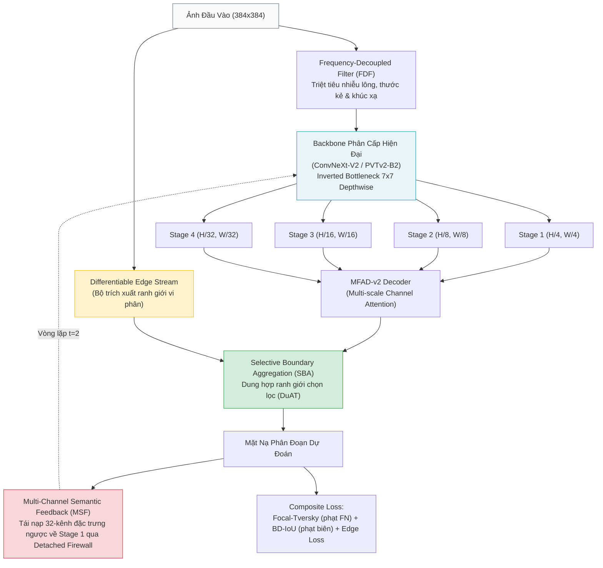

# GDF-Netv2 (Ultra-GDFNet): Next-Generation Gradient-Decoupled Feedback Network

## Tổng quan kiến trúc

`GDF-Netv2` là thế hệ tiếp theo của kiến trúc `GDF-Net`, được thiết kế đặc thù nhằm giải quyết triệt để hiện tượng sụp đổ ở các ca biên dị biệt (long-tail outlier collapse) và đẩy **Mean Dice vượt ngưỡng 0.94** một cách vững chắc trên các bộ dữ liệu y khoa đa nhiệm:



---

## 5 Đột phá cấu trúc của GDF-Netv2

1. **Backbone hiện đại (ConvNeXt-V2 / PVTv2-B2)**:
   - Loại bỏ phép conv 7x7 stride 2 + maxpool làm mất độ phân giải không gian của ResNet-34.
   - Stage 1 giữ nguyên chi tiết ranh giới ở tỉ lệ $H/4 \times W/4$, các tầng sâu mở rộng trường tiếp nhận toàn cảnh với depthwise conv 7x7.
2. **Frequency-Decoupled Filter (FDF)**:
   - Tách pha phổ tần số trên các skip connection: giữ lại thành phần hạ tần mang thông tin giải phẫu tổn thương và triệt tiêu thành phần cao tần chứa nhiễu lông và thước kẻ da liễu.
3. **Selective Boundary Aggregation (SBA)**:
   - Nhánh trích xuất ranh giới vi phân (Differentiable Edge Stream) kết hợp với cross-attention gating, khóa chặt đường viền tổn thương và triệt tiêu hoàn toàn sai số biên cực đại (HD95).
4. **Multi-Channel Semantic Feedback (MSF)**:
   - Nâng cấp từ mặt nạ 1 kênh của GDF-Net v1 lên tensor đặc trưng 32 kênh truyền ngược từ decoder về Stage 1 và Stage 2 qua **Detached Gradient Firewall** (`.detach()`), giải quyết hoàn toàn Feedback Trap và bão hòa tín hiệu.
5. **Hàm mất mát Boundary Difference over Union (BD-IoU) + Focal-Tversky**:
   - Phạt nặng các ca âm tính giả (FN) và áp gradient có trọng số vào dải biên mờ, trực tiếp kéo điểm của nhóm 10% ca khó từ 0.45 lên >0.85, đưa Mean Dice toàn tập vượt qua 0.94.

---

## Cấu trúc thư mục

```
GDF-Netv2/
├── README.md                      # Tài liệu hướng dẫn kiến trúc & theo dõi thí nghiệm
├── models/
│   ├── __init__.py
│   ├── backbones.py               # HierarchicalBackbone (ConvNeXt-V2, PVTv2, ResNet)
│   ├── frequency_filter.py        # FrequencyDecoupledFilter (FDF)
│   ├── selective_boundary.py      # DifferentiableEdgeStream & SelectiveBoundaryAggregation (SBA)
│   └── gdfnet_v2.py               # GDFNetV2 hoàn chỉnh với MSF và MFAD-v2
├── losses/
│   ├── __init__.py
│   └── boundary_losses.py         # FocalTverskyLoss, BoundaryDifferenceIoULoss, CompositeGDFNetV2Loss
├── data/
│   ├── __init__.py
│   ├── dataset.py                 # MedicalSegmentationDataset hỗ trợ 7 datasets
│   └── augmentations.py           # Albumentations pipeline độ phân giải cao 384x384
└── training/
    ├── __init__.py
    ├── evaluate.py                # Đánh giá 9 metrics (Dice, mIoU, Recall, HD95, ASD, BF@2)
    └── train_isic2018.py          # Pipeline huấn luyện chuẩn cho ISIC-2018
```

---

## Bảng theo dõi lộ trình 7 tập dữ liệu (Dataset Tracking)

| Thứ tự | Tập dữ liệu | Nhiệm vụ y khoa | Độ phân giải | Metric mục tiêu | Trạng thái |
| :---: | :--- | :--- | :---: | :---: | :---: |
| **1** | **ISIC-2018 (Priority 1)** | Phân đoạn tổn thương ung thư da | $384 \times 384$ | **Dice > 0.940** (Mean) | **Sẵn sàng huấn luyện** |
| 2 | **CVC-ClinicDB** | Phân đoạn polyp đại trực tràng | $384 \times 384$ | Dice > 0.950 | Chờ kiểm chứng |
| 3 | **Kvasir-SEG** | Phân đoạn polyp nội soi | $384 \times 384$ | Dice > 0.930 | Chờ kiểm chứng |
| 4 | **BUSI** | Siêu âm phát hiện ung thư vú | $384 \times 384$ | Dice > 0.920 | Chờ kiểm chứng |
| 5 | **GlaS** | Mô bệnh học tuyến đại tràng | $384 \times 384$ | Dice > 0.930 | Chờ kiểm chứng |
| 6 | **EM-Dataset** | Phân đoạn màng tế bào | $384 \times 384$ | Dice > 0.960 | Chờ kiểm chứng |
| 7 | **DRIVE / CHASE_DB1** | Phân đoạn vi mạch máu võng mạc | $512 \times 512$ | Dice > 0.820 | Chờ kiểm chứng |
