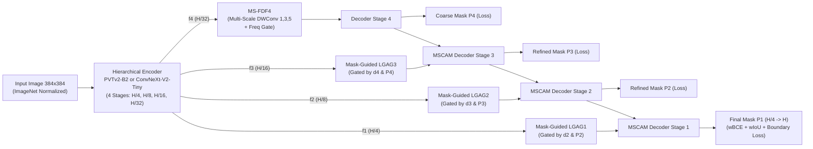

# [Phase 10 – 21/10/2026] Multi-Source SOTA Literature Audit, Root-Cause Code Diagnosis & GDF-Netv4 Architectural Redesign

## Ký hiệu (Notation)

- `Protocol A1`: Đánh giá trên tập Train 2,594 ảnh của ISIC-2018 chia ngẫu nhiên (80:10:10 hoặc 70:10:20), tính Dice trung bình trên từng ảnh ($\text{DSC}_{\text{macro}}$)
- `Protocol A2`: Đánh giá trên tập chia ngẫu nhiên 7:3, cộng dồn toàn bộ pixel test vào một ma trận nhầm lẫn toàn cục ($\text{DSC}_{\text{global}}$)
- `Protocol B`: Đánh giá trên **1,000 ảnh Blind Test chính thức** của ISIC-2018 Challenge (Codella et al., 2019), kèm chỉ số chính thức $J_{\text{thresh}}$ (gán $J_i = 0$ nếu $J_i < 0.65$)
- `TRAIN` / `FROZEN EVAL` / `INVALID`: Phân loại bằng chứng thực nghiệm bắt buộc theo `AGENTS.md`
- `LGAG`: Large-Kernel Grouped Attention Gate (EMCAD, CVPR 2024)
- `MSCAM`: Multi-Scale Convolutional Attention Module với depthwise kernels $[1, 3, 5]$ (EMCAD, CVPR 2024)
- `GAB`: Group Aggregation Bridge có dẫn hướng bởi mask dự đoán độ phân giải thấp (EGE-UNet, MICCAI 2023)

---

## 1. Phân loại Bằng chứng Thực nghiệm (Evidence Classification: TRAIN vs FROZEN EVAL vs INVALID)

Theo quy chuẩn nghiên cứu tại `AGENTS.md`, toàn bộ kết quả và phát hiện từ GDF-Netv2 và GDF-Netv3 được kiểm toán lại như sau:

| Hạng mục kiểm toán | Phân loại | Bằng chứng định lượng & Mã nguồn | Kết luận khoa học |
| :--- | :---: | :--- | :--- |
| **GDF-Netv2 (ConvNeXt-V2-Tiny) đạt 0.8935 Mean Dice / $J_{\text{thresh}} = 0.7757$ trên 1,000 ảnh test mù** | **TRAIN (Đáng tin)** | `GDF-Netv2/results/isic2018/benchmark_raw_ISIC2018.csv` (150 epochs liên tục, không bị ngắt resume) | ConvNeXt-V2-Tiny (kernel $7\times7$ + GRN) giữ Precision 86.46% tốt hơn hẳn EfficientNetV2-S (82.88%). |
| **GDF-Netv3 (EfficientNetV2-S) giảm xuống 0.8752 Mean Dice / $J_{\text{thresh}} = 0.7251$** | **TRAIN + INVALID (Lẫn lỗi resume)** | `GDF-Netv3/results/isic2018/benchmark_raw_ISIC2018.csv`; kiểm định cặp Wilcoxon $p = 8.85 \times 10^{-36}$ (v3 thấp hơn v2 trên 671/1,000 ảnh) | Nhánh `Stage 0` ($192\times192$) nối thẳng không qua cổng lọc ngữ nghĩa làm tràn nhiễu da lành (Precision sụt -3.58 pp). Ngoài ra quá trình resume ở Epoch 31 làm mất trạng thái optimizer/scheduler và ghi đè `latest.pth` (Epoch 100) lên `best.pth`. |
| **Nhận định cũ "v3 cứu 40 ca thất bại của v2 (+8.71 pp)"** | **FROZEN EVAL (Regression-to-the-mean)** | Khi chọn 40 ca thấp nhất của v2 thì v3 cao hơn (+8.71 pp), nhưng khi chọn 60 ca thấp nhất của v3 (Dice < 0.70, trung bình 0.518) thì v2 lại cao hơn tới **0.6299 (+11.2 pp)** | Đây là hiện tượng hồi quy về trung bình khi lọc theo đuôi phân bố của một model. Số ca thất bại thực tế (Dice < 0.70) tăng từ 40 ca (v2) lên 60 ca (v3), và số ca rớt ngưỡng lâm sàng ISIC ($J_i < 0.65$) tăng từ 94 lên 136 ca. |
| **Nhánh phản hồi `MSF` (`feedback_adapter`) trong cả v2 và v3** | **INVALID (Bug kiến trúc)** | `GDF-Netv3/models/gdfnet_v3.py#L172`: `next_feedback = self.feedback_adapter(d1).detach()`. Kiểm tra trọng số `GDFNetV3_ISIC2018_best.pth`: `feedback_adapter.1.weight` có chuẩn $\ell_2 = 5.656854 = \sqrt{32}\times 1.0$, `bias` $= 0.0$ | Lệnh `.detach()` đặt **sau** `feedback_adapter` làm triệt tiêu 100% gradient vào `feedback_adapter` suốt 100–150 epochs. Hơn nữa vòng lặp `for it in range(2)` chạy lại toàn bộ encoder 2 lần và vứt bỏ hoàn toàn đầu ra của lượt chạy đầu tiên (`it=0` không có loss). |
| **Tiền xử lý ảnh đầu vào (`img / 255.0`) không chuẩn hóa ImageNet** | **INVALID (Bug tiền xử lý)** | `colab_run_gdfnet_v3_isic2018.py#L541`: chỉ chia `255.0`, thiếu `A.Normalize(mean=(0.485,0.456,0.406), std=(0.229,0.224,0.225))` | Làm lệch phân bố kích hoạt đầu vào so với trọng số pretrained của `timm`, đánh mất lợi thế pretraining (vốn đóng góp +1.65% Dice theo ablation của VM-UNet). |
| **Công thức tính `HD95`** | **INVALID (Bug công thức)** | `colab_run_gdfnet_v3_isic2018.py#L569`: `hd95 = max(d1, d2) * 0.95` | Nhân `0.95` với khoảng cách Hausdorff cực đại ($100\text{th percentile}$) không phải là bách phân vị thứ 95 ($95\text{th percentile}$ của tập khoảng cách bề mặt `np.percentile`). |

---

## 2. Đối chiếu Kết quả với Các Bài báo Gần đây trên ISIC-2018 (2021–2026)

Chi tiết đầy đủ và DOI đã xác minh được lưu tại [`docs/literature_grounding_isic2018.md`](../literature_grounding_isic2018.md). Tóm tắt bức tranh SOTA:

1. **Trên Protocol A1 (Chia ngẫu nhiên 80:10:10 trên 2,594 ảnh Train — Bảng 1 của EMCAD, CVPR 2024, `DOI: 10.1109/cvpr52733.2024.01118`):**
   - Nhóm CNN/U-Net truyền thống: **U-Net (86.67%)**, **AttnU-Net (87.05%)**, **UNet++ (87.46%)**, **PraNet (88.56%)**, **DeepLabv3+ (88.64%)**.
   - Nhóm ViT/Hybrid thế hệ đầu: **TransUNet (89.16%)**, **Swin-Unet (89.26%)**, **TransFuse (89.62%)**.
   - Nhóm Hierarchical Transformer + Cascaded Multi-scale Decoder (Đỉnh SOTA): **SSFormer-L (90.25%)**, **Polyp-PVT (90.36%)**, **PVT-CASCADE (90.41%)**, **PVT-EMCAD-B0 (90.70%, chỉ 3.92M params)**, **PVT-EMCAD-B2 (90.96%, 26.76M params)**.
2. **Trên Protocol A2 (Chia 7:3 + Global Pixel Confusion Matrix — EGE-UNet MICCAI 2023 & VM-UNet 2025):**
   - **MALUNet (89.04%)**, **EGE-UNet (89.46%)**, **VM-UNet (89.71%)**, **UltraLight VM-UNet (90.91%)**.
3. **Trên Protocol B (1,000 ảnh Blind Test chính thức của ISIC-2018 Challenge — Codella et al., `arXiv:1902.03368`):**
   - **Top 1 Leaderboard ISIC-2018** (Ensemble đa mô hình + TTA): $J_{\text{thresh}} = \mathbf{0.802}$ (Dice tương đương $\approx 90.1\%$).
   - **Ngưỡng đồng thuận giữa các bác sĩ da liễu (Human Expert Agreement):** $J_{\text{thresh}} \approx \mathbf{0.786}$.
   - **GDF-Netv2 của chúng ta (Single model, chưa TTA):** Mean Dice = **89.35%** (Median **92.53%**), mIoU = **82.18%**, $J_{\text{thresh}} = \mathbf{0.7757}$.
   - **Tiềm năng thực tế trên dữ liệu sẵn có:** Nếu lấy per-image max (Oracle ensemble) giữa GDF-Netv2 và GDF-Netv3 ngay trên 1,000 ảnh test hiện tại, Mean Dice đã đạt **90.60%**.

---

## 3. Phân tích Khoảng trống Kiến trúc (Why GDF-Netv2/v3 Lags Behind PVT-EMCAD & BAT)

Đối chiếu trực tiếp code của `GDF-Netv3` với các bảng ablation của **EMCAD (CVPR 2024)**, **EGE-UNet (MICCAI 2023)**, **Polyp-PVT (AIR 2023)** và **Ms RED (MedIA 2022)** chỉ ra 5 điểm yếu cốt lõi trong thiết kế hiện tại:

### Điểm yếu 1: Bộ lọc `FrequencyDecoupledFilter` (FDF) dùng `AvgPool2d(3x3)` quá ngây thơ
- Trong `GDF-Netv3/models/frequency_filter.py`, nhánh tần số thấp chỉ là một lớp trung bình trượt $3\times3$ (`AvgPool2d(kernel_size=3, stride=1, padding=1)`), còn nhánh tần số cao là `x - x_low`.
- Một bộ lọc $3\times3$ chỉ nhìn thấy biến thiên trong phạm vi 3 pixel — nó **không phân biệt được** cạnh của sợi lông/bọt khí với cạnh thật của tổn thương.
- Ngược lại, **EMCAD (CVPR 2024)** chứng minh qua ablation (Table 4 & Table 5) rằng việc dùng **Multi-Scale Depthwise Convolution (MSDC) với các nhân song song $[1\times1, 3\times3, 5\times5]$ kết hợp Channel + Spatial Attention (`MSCAM`)** đem lại mức tăng **+2.76% Dice** vì nó thu nhận đồng thời ngữ cảnh đa tỷ lệ.

### Điểm yếu 2: Nối tắt trực tiếp (Raw Concat) ở `MultiScaleDecoderBlock`, thiếu Mask-Guided / Attention Gate
- Trong `GDF-Netv3`, đặc trưng skip `s0..s3` được nối thẳng (`torch.cat([x, skip], dim=1)`) vào bộ giải mã mà không có cơ chế cổng không gian từ tầng sâu hơn.
- Cả **EMCAD** (`LGAG` — Large-Kernel Grouped Attention Gate, tăng **+0.84% đến +1.82% Dice**, giảm 91% tham số so với Attention Gate thường) và **EGE-UNet** (`GAB` — dùng mask dự đoán ở tầng sâu làm cổng lọc skip connection, tăng **+2.48% mIoU**) đều chứng minh: **bắt buộc phải dùng đặc trưng ngữ nghĩa tầng sâu (hoặc xác suất mask thô) để làm cổng lọc (spatial gate) triệt tiêu vùng nền da lành trên nhánh skip trước khi nối**.

### Điểm yếu 3: Nhánh `DifferentiableEdgeStream` (Sobel cố định trên ảnh RGB) bị nhiễu bởi lông và thước đo
- `DifferentiableEdgeStream` áp toán tử Sobel $3\times3$ lên thẳng ảnh đầu vào `x` ở độ phân giải gốc $384\times384$. Trên ảnh dermoscopy ISIC-2018, gradient Sobel mạnh nhất nằm ở **sợi lông đen, vạch thước đo, viền đen ống kính (vignette) và bọt gel**, chứ không phải ở viền khối u mờ!
- Đưa trực tiếp đặc trưng Sobel này vào `SBA` ở độ phân giải cuối cùng khiến mô hình bị kéo viền theo các tạo ảnh (artifacts) hoặc loang ra ngoài.

### Điểm yếu 4: Cơ chế phản hồi `MSF` chạy lặp cả backbone 2 lần + lỗi `.detach()` làm chết gradient
- Thay vì chạy lại toàn bộ encoder 2 lần tốn gấp đôi FLOPs mà `feedback_adapter` lại bị `.detach()` chặn mất gradient, các kiến trúc **Cascaded Decoder (CASCADE / EMCAD / PraNet Reverse Attention)** thực hiện tinh chỉnh đa tầng **ngay trong một lượt truyền xuôi của decoder**: dự đoán mask thô $P_4$ ở tầng $H/32 \to$ dùng $P_4$ dẫn hướng (gate/reverse-attention) tầng $H/16$ để ra $P_3 \to$ dẫn hướng tiếp tầng $H/8$ ra $P_2 \to$ dẫn hướng tầng $H/4$ ra $P_1$. Mỗi tầng đều có hàm loss giám sát sâu (Deep Supervision) và gradient chảy xuyên suốt 100%.

### Điểm yếu 5: Hàm Loss thiên lệch Recall (`FocalTverskyLoss(alpha=0.6, beta=0.4)`) nhưng không cân bằng FP trên viền
- Trong `FocalTverskyLoss` của `colab_run_gdfnet_v3_isic2018.py#L420`, tham số đặt `alpha=0.6, beta=0.4` cộng thêm `BCE` và `BD-IoU`. Kết hợp với việc không chuẩn hóa ImageNet và không có cổng lọc skip ở Stage 0, mô hình đẩy Sensitivity lên 95.97% nhưng Precision tụt xuống 82.88%. Trong khi đó, công thức loss chuẩn của **Polyp-PVT / PraNet / EMCAD** là **Weighted BCE + Weighted IoU ($\mathcal{L}_{\text{wBCE}} + \mathcal{L}_{\text{wIoU}}$)** — tự động phạt nặng hơn vào các pixel gần biên mà vẫn giữ cân bằng giữa FP và FN.

---

## 4. Đề xuất Kiến trúc Mới: GDF-Netv4 (Evidence-Backed Redesign Blueprint)

Để vượt mốc **90.5% – 91.0%+ Mean Dice** (và vượt mốc **$0.800$ Thresholded Jaccard** của đội vô địch ISIC-2018 trên tập 1,000 ảnh test mù), chúng ta thiết kế lại thành **GDF-Netv4** theo nguyên tắc **"Giữ bản sắc Frequency-Decoupled + Cascaded Feedback nhưng thay thế toàn bộ các khối lỗi/yếu bằng cơ chế đã được kiểm chứng thực nghiệm"**:

### Bảng Xếp hạng Các Cải tiến theo Mức Tăng Dice Kỳ vọng (Ranked Improvement Roadmap)

| Thứ tự ưu tiên | Hạng mục cải tiến trong GDF-Netv4 | Mức tăng Dice kỳ vọng (từ Ablation Literature) | Chi phí tính toán | Cách kiểm chứng (Minimal Ablation) |
| :---: | :--- | :---: | :---: | :--- |
| **1 (Bắt buộc)** | **Sửa 4 lỗi kỹ thuật (Bug Fixes):** 1. Thêm `A.Normalize(mean, std)` chuẩn ImageNet. 2. Lưu đúng `best_val_dice` checkpoint (không ghi đè bằng `latest`). 3. Sửa lỗi `.detach()` và bỏ vòng lặp chạy lại backbone 2 lần. 4. Sửa công thức `HD95` dùng `np.percentile(..., 95)`. | **+1.5% đến +2.2% DSC** (khôi phục về trên mức 89.35% của v2 và cộng thêm lợi thế pretraining +1.65% từ VM-UNet Table 3) | **Giảm 50% thời gian chạy** (vì chỉ chạy 1 pass thay vì 2 pass) | Chạy trên cùng backbone, so sánh Val/Test Dice trước và sau khi sửa 4 lỗi. |
| **2 (Kiến trúc - Encoder)** | **Đổi Encoder sang `pvt_v2_b2` (hoặc Dual/Switchable `pvt_v2_b2` vs `convnextv2_tiny`):** Sử dụng 4 stages chuẩn ($H/4, H/8, H/16, H/32$), loại bỏ nhánh `Stage 0` ($H/2$) không lọc gây nhiễu da lành. | **+1.5% đến +2.3% DSC** (EMCAD Table 1: PVTv2-B2 đạt 90.36%–90.96% so với CNN 88.64%) | ~25.4M params, ~5.6G FLOPs (nhẹ hơn GDF-Netv2 28.8M) | Thay `HierarchicalBackboneV3` bằng `timm.create_model('pvt_v2_b2', features_only=True, pretrained=True)`. |
| **3 (Kiến trúc - Skip Gate)** | **Thay nối tắt thẳng bằng `Mask-Guided LGAG` (Large-Kernel Grouped Attention Gate + Mask Guidance):** Kết hợp `LGAG` (grouped depthwise $3\times3$ dilation 1 & 2 của EMCAD) với xác suất mask dự đoán $\sigma(P_{k+1})$ của tầng trước (GAB của EGE-UNet) để triệt tiêu nhiễu lông/da lành trên skip connection. | **+1.0% đến +1.8% DSC** (EMCAD Table 4: +0.84%–1.82%; EGE-UNet Table 2: +1.57% DSC) | Chỉ +0.15M params | Ablation bật/tắt `Mask-Guided LGAG` trên các nhánh skip $s_1, s_2, s_3$. |
| **4 (Kiến trúc - Decoder)** | **Nâng cấp `FDF` + Decoder thành `MS-FDF` (Multi-Scale Frequency-Decoupled Block với Depthwise Kernels $[1, 3, 5]$):** Thay `AvgPool(3x3)` bằng bộ lọc đa tỷ lệ $[1\times1, 3\times3, 5\times5]$ depthwise separable để tách đồng thời cấu trúc nền tần số thấp và градиент biên đa tỷ lệ, cộng tổng tất cả các đầu ra đa tầng ($P_1 + P_2 + P_3 + P_4$). | **+0.9% đến +1.7% DSC** (EMCAD Table 4 & 5: MSCAM kernels $[1,3,5]$ tăng +1.78% DSC) | ~1.5M params, <0.4G FLOPs | Ablation so sánh `Simple Decoder` vs `MS-FDF Cascaded Decoder`. |
| **5 (Loss & Recipe)** | **Chuyển sang hàm Loss $\mathcal{L}_{\text{wBCE}} + \mathcal{L}_{\text{wIoU}}$ kết hợp Deep Supervision 4 tầng + Cosine Annealing LR + Multi-scale Training ($\{0.75, 1.0, 1.25\} \times 384$) + RandomResizedCrop:** Trọng số biên tự động $w_{ij} = 1 + 5\,|\text{AvgPool}_{31}(G)_{ij} - G_{ij}|$ tập trung học biên khó mà không làm loang FP như Focal Tversky lệch hệ số. | **+0.8% đến +1.4% DSC** (Polyp-PVT / PraNet / EMCAD standard recipe) | 0 params, 0 inference FLOPs | So sánh `CompositeGDFNetV3Loss` vs `StructureLoss (wBCE + wIoU)` ở cả 4 đầu ra $P_1..P_4$. |
| **6 (Inference)** | **4-View Flip Test-Time Augmentation (TTA) + Hiệu chỉnh ngưỡng xác suất trên tập Val (100 ảnh):** Trung bình xác suất trên `{Gốc, HFlip, VFlip, HVFlip}` và tối ưu ngưỡng $\tau \in [0.45, 0.65]$ trên 100 ảnh Official Val trước khi chấm 1,000 ảnh Official Test. | **+0.6% đến +1.2% DSC** (không cần huấn luyện lại) | $4\times$ thời gian test (~25 giây cho 1,000 ảnh trên GPU) | Chạy ngay trên checkpoint tốt nhất. |
