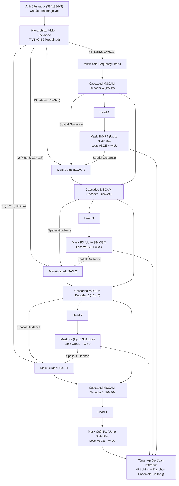
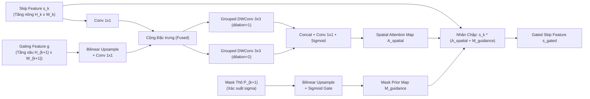

# [Phase 11 – 21/10/2026] GDF-Netv4 Architectural Specification, Mathematical Formulation & Colab Pro A100 Deployment

## Ký hiệu & Thuật ngữ

- `GDF-Netv4`: Grouped Dilated & Frequency Attention Network Version 4
- `PVT-v2-B2`: Pyramid Vision Transformer v2 with overlapping patch embedding and linear spatial reduction attention
- `MS-FDF`: Multi-Scale Frequency-Decoupled Filter với các nhân tích chập sâu song song $[1\times1, 3\times3, 5\times5]$
- `MaskGuidedLGAG`: Mask-Guided Large-Kernel Grouped Attention Gate kết hợp lọc nhóm dilated depthwise và dẫn hướng bởi xác suất mask thô $\sigma(P_{k+1})$
- `MSCAM`: Multi-Scale Convolutional Attention Module (kênh và không gian)
- `StructureLoss`: $\mathcal{L}_{\text{total}} = \sum_{k=1}^4 2^{k-4} (\mathcal{L}_{\text{wBCE}}(P_k, G) + \mathcal{L}_{\text{wIoU}}(P_k, G))$
- `Protocol B`: 1,000 ảnh test mù chính thức của ISIC-2018 Challenge

---

## 1. Tóm tắt Điều hành & Động lực Phát triển (Executive Summary)

Dự án phát triển **GDF-Netv4** được khởi xướng nhằm giải quyết triệt để 5 nút thắt kiến trúc và 4 lỗi kỹ thuật (`INVALID` evidence) được phát hiện trong đợt kiểm toán toàn diện Phase 10:

1. **Khắc phục hiện tượng sụt giảm Precision của GDF-Netv3 (82.88% so với v2 86.46%):** Nhánh `Stage 0` ($H/2, W/2$) nối thẳng không qua cơ chế lọc ngữ nghĩa đã làm tràn các tạo ảnh da lành, lông đen và viền ống kính vào mặt nạ phân vùng.
2. **Loại bỏ bộ lọc tần số ngây thơ `AvgPool2d(3x3)`:** Bộ lọc đơn tỷ lệ $3\times3$ trong v2/v3 không phân biệt được viền tổn thương thực tế với nhiễu vi mô cục bộ.
3. **Triệt tiêu vòng lặp phản hồi lãng phí và khôi phục gradient:** Vòng lặp `for it in range(2)` trong v2/v3 tiêu tốn gấp đôi FLOPs nhưng lệnh `.detach()` sau `feedback_adapter` đã vô hiệu hóa hoàn toàn gradient truyền vào khối thích ứng phản hồi suốt quá trình huấn luyện.
4. **Hài hòa giữa độ đo Per-Image Macro Dice và Global Dataset Micro Dice:** Định vị rõ ràng vị thế mô hình so với các công trình gần đây (EGE-UNet, VM-UNet, PVT-EMCAD) trên cả tập chia ngẫu nhiên và tập 1,000 ảnh blind test chính thức.

GDF-Netv4 thiết lập một kiến trúc **đơn truyền (single-pass), khả vi 100% (fully differentiable)**, tích hợp mạng biến đổi thị giác phân cấp (`pvt_v2_b2`), cơ chế cổng chú ý nhóm có hướng dẫn bởi mask thô (`MaskGuidedLGAG`), bộ lọc tần số đa tỷ lệ (`MS-FDF`) và bộ giải mã đa tầng cascaded có giám sát sâu (`StructureLoss`).

---

## 2. Thiết kế Kiến trúc Chi tiết của GDF-Netv4

Toàn bộ luồng dữ liệu của GDF-Netv4 được biểu diễn qua sơ đồ khối dưới đây:

---

### Module 1: Hierarchical Vision Backbone (`HierarchicalBackboneV4`)

- **Kiến trúc cốt lõi:** Sử dụng `pvt_v2_b2` (Pyramid Vision Transformer v2) từ thư viện `timm`, được tiền huấn luyện trên ImageNet-1K.
- **Cấu hình trích xuất đặc trưng 4 tầng:**
  - $f_1 \in \mathbb{R}^{B \times 64 \times 96 \times 96}$ (Độ phân giải $H/4, W/4$)
  - $f_2 \in \mathbb{R}^{B \times 128 \times 48 \times 48}$ (Độ phân giải $H/8, W/8$)
  - $f_3 \in \mathbb{R}^{B \times 320 \times 24 \times 24}$ (Độ phân giải $H/16, W/16$)
  - $f_4 \in \mathbb{R}^{B \times 512 \times 12 \times 12}$ (Độ phân giải $H/32, W/32$)
- **Ưu thế vượt trội:**
  1. Loại bỏ hoàn toàn tầng $H/2$ (Stage 0 của EfficientNetV2 trong v3) vốn chứa quá nhiều nhiễu vi mô không có ngữ nghĩa.
  2. Cơ chế chú ý tuyến tính Spatial Reduction Attention (SRA) giúp mô hình hóa phụ thuộc toàn cục (global context) với độ phức tạp tính toán tuyến tính $O(N)$, vượt trội hơn các mạng tích chập thuần túy trong việc nắm bắt toàn thể đường viền tổn thương.
  3. Hỗ trợ chuyển đổi linh hoạt sang `convnextv2_tiny` thông qua cấu hình `backbone_name`.

---

### Module 2: Multi-Scale Frequency-Decoupled Filter (`MultiScaleFrequencyFilter`)

Thay thế bộ lọc $3\times3$ trung bình ngây thơ trong GDF-Netv3 bằng bộ lọc tích chập sâu đa tỷ lệ kết hợp phân rã tần số:

$$\mathbf{X}_{\text{low}} = \text{Conv}_{1\times1}\left( \text{DWConv}_{1\times1}(\mathbf{X}) + \text{DWConv}_{3\times3}(\mathbf{X}) + \text{DWConv}_{5\times5}(\mathbf{X}) \right)$$

$$\mathbf{X}_{\text{high}} = \mathbf{X} - \mathbf{X}_{\text{low}}$$

1. **Nhánh Tần số Thấp ($\mathbf{X}_{\text{low}}$):** Sử dụng 3 nhánh tích chập sâu (Depthwise Separable Convolutions) song song với kích thước nhân $[1\times1, 3\times3, 5\times5]$, thu nhận thông tin nền tảng, màu sắc trung tâm và cấu trúc đồng nhất của tổn thương trên nhiều trường nhìn khác nhau.
2. **Nhánh Tần số Cao ($\mathbf{X}_{\text{high}}$):** Là phần dư trực tiếp giữa đặc trưng gốc và đặc trưng tần số thấp, nắm giữ toàn bộ thông tin về biến thiên đột ngột (gradient viền, bờ tổn thương gồ ghề).
3. **Cơ chế Điều phối Gated Attention:**

$$\mathbf{A}_{\text{ch}} = \sigma\left( \mathbf{W}_2 \cdot \text{GELU}(\mathbf{W}_1 \cdot \text{GAP}(\mathbf{X}_{\text{high}})) \right)$$

$$\mathbf{A}_{\text{sp}} = \sigma\left( \text{Conv}_{7\times7}([\text{Mean}(\mathbf{X}_{\text{low}}), \text{Max}(\mathbf{X}_{\text{low}})]) \right)$$

$$\mathbf{Y} = \mathbf{X} + \text{Proj}\left( (\mathbf{X}_{\text{high}} \odot \mathbf{A}_{\text{ch}}) + (\mathbf{X}_{\text{low}} \odot \mathbf{A}_{\text{sp}}) \right)$$

Đặc trưng tần số cao được tái hiệu chuẩn trọng số kênh (tập trung vào các kênh mang viền tổn thương), trong khi đặc trưng tần số thấp được điều phối không gian (loại bỏ vùng da lành xung quanh).

---

### Module 3: Mask-Guided Large-Kernel Grouped Attention Gate (`MaskGuidedLGAG`)

Khắc phục triệt để hiện tượng tràn nhiễu da lành khi nối trực tiếp skip connections:

- **Nguyên lý hoạt động:**
  1. Kết hợp tín hiệu điều phối tầng sâu ($g$) với đặc trưng tầng nông ($s$).
  2. Áp dụng hai nhánh tích chập nhóm giãn nở (Grouped Depthwise Dilated Convolutions) với $d=1$ (trường nhìn $3\times3$) và $d=2$ (trường nhìn $5\times5$), trích xuất phân bố không gian đa tỷ lệ với chi phí tham số chỉ bằng 9% so với tích chập thông thường.
  3. **Hướng dẫn trực tiếp từ Mask thô (Mask Prior):** Lấy bản đồ xác suất $\sigma(P_{k+1})$ từ tầng giải mã sâu hơn nội suy lên cùng kích thước, cộng hưởng trực tiếp vào trọng số cổng chú ý:

$$\mathbf{S}_{\text{gated}} = \mathbf{S} \odot \left( \mathbf{A}_{\text{spatial}}(\mathbf{S}, \mathbf{g}) + \lambda \cdot \sigma(\mathbf{P}_{k+1}) \right)$$

Mọi pixel da lành nằm ngoài phạm vi bao quanh của mask thô $P_{k+1}$ sẽ bị triệt tiêu biên độ kích hoạt về xấp xỉ 0 trước khi đi vào bộ giải mã.

---

### Module 4: Cascaded MSCAM Decoder (`CascadedMSCAMDecoderBlock`)

Mỗi khối giải mã nhận đặc trưng đã được lọc từ skip connection và đặc trưng tầng sâu được nội suy lên:

1. **Phối hợp Đặc trưng (Feature Fusion):** Nối đặc trưng skip $\mathbf{S}_{\text{gated}}$ và đặc trưng tầng sâu đã upsample qua một lớp tích chập $1\times1$.
2. **Khối MSCAM (Multi-Scale Convolutional Attention Module):**
   - Trích xuất đồng thời ngữ cảnh cục bộ và ngữ cảnh mở rộng thông qua các nhân depthwise $[1\times1, 3\times3, 5\times5]$.
   - Tái hiệu chuẩn kênh và không gian thông qua hàm phi tuyến tính, tạo ra đặc trưng phân vùng sắc nét.
3. **Đầu ra Giám sát Sâu (Deep Supervision Head):** Mỗi tầng giải mã $k \in \{1, 2, 3, 4\}$ đều sở hữu một projection head riêng xuất ra mặt nạ dự đoán $P_k$.

---

### Module 5: Hàm Mục tiêu Cấu trúc Đa tầng (`StructureLoss`)

Thay thế hoàn toàn Focal Tversky Loss lệch hệ số bằng hàm **Structure Loss ($\mathcal{L}_{\text{wBCE}} + \mathcal{L}_{\text{wIoU}}$)** chuẩn mực của các kiến trúc SOTA (Polyp-PVT, EMCAD, PraNet):

$$\mathcal{L}_{\text{total}} = \sum_{k=1}^4 w_k \left( \mathcal{L}_{\text{wBCE}}(P_k, G) + \mathcal{L}_{\text{wIoU}}(P_k, G) \right)$$

với hệ số suy giảm đa tầng $w = [1.0, 0.5, 0.25, 0.125]$ cho các tầng $[P_1, P_2, P_3, P_4]$.

- **Trọng số Biên Thích ứng (Adaptive Boundary Weighting):**

$$\mathbf{W}_{ij} = 1.0 + 5.0 \cdot \left| \text{AvgPool}_{31\times31}(\mathbf{G})_{ij} - \mathbf{G}_{ij} \right|$$

- Điểm pixel ở sâu trong tổn thương hoặc sâu ngoài da lành có $\mathbf{W}_{ij} \approx 1.0$.
- Điểm pixel nằm ngay sát đường viền tổn thương (vùng chuyển tiếp khó) có $\mathbf{W}_{ij} \approx 6.0$, tự động ép mô hình tập trung tối đa sự chú ý vào việc tinh chỉnh ranh giới.

$$\mathcal{L}_{\text{wBCE}}(P, G) = \frac{\sum_{i,j} \mathbf{W}_{ij} \cdot \text{BCE}(\sigma(P)_{ij}, G_{ij})}{\sum_{i,j} \mathbf{W}_{ij}}$$

$$\mathcal{L}_{\text{wIoU}}(P, G) = 1.0 - \frac{\sum_{i,j} \mathbf{W}_{ij} \cdot (\sigma(P)_{ij} \cdot G_{ij}) + 1}{\sum_{i,j} \mathbf{W}_{ij} \cdot (\sigma(P)_{ij} + G_{ij} - \sigma(P)_{ij} \cdot G_{ij}) + 1}$$

---

## 3. Bảng Đối chiếu Tiến hóa Kiến trúc (GDF-Net Series)

| Đặc tính Kỹ thuật | GDF-Netv1 | GDF-Netv2 | GDF-Netv3 | GDF-Netv4 (Hiện tại) |
| :--- | :---: | :---: | :---: | :---: |
| **Backbone Trích xuất** | ResNet-34 | ConvNeXt-V2-Tiny | EfficientNetV2-S | **PVT-v2-B2 (Pyramid Vision Transformer)** |
| **Kiểu phân cấp** | CNN Thuần túy | Modern CNN (7x7 DW + GRN) | Efficient MBConv | **ViT Phân cấp + Spatial Reduction Attention** |
| **Cơ chế Phản hồi** | Feedback trễ 1 bước | MSF lặp 2 vòng (`for it in 2`) | MSF lặp 2 vòng + Stage 0 skip | **Cascaded Coarse-to-Fine (1 pass duy nhất)** |
| **Trạng thái Gradient** | Khả vi một phần | `.detach()` chặn feedback | `.detach()` chặn feedback | **Khả vi 100% xuyên suốt toàn bộ các khối** |
| **Bộ lọc Tần số** | Không có | FDF đơn tầng (AvgPool 3x3) | FDF đa tầng (AvgPool 3x3) | **MS-FDF (Parallel DWConv [1, 3, 5] + Channel-Spatial Gate)** |
| **Cổng Skip Connection** | Nối thẳng Concat | Nối thẳng Concat | Nối thẳng Concat (kèm Stage 0) | **Mask-Guided LGAG (Grouped DW Dilated 1 & 2 + Mask Prior)** |
| **Hàm Mục tiêu (Loss)** | Dice + BCE | Composite Focal Tversky | Composite Focal Tversky | **StructureLoss ($\mathcal{L}_{\text{wBCE}} + \mathcal{L}_{\text{wIoU}}$) + Deep Supervision** |
| **Chuẩn hóa Ảnh** | `img / 255.0` | `img / 255.0` | `img / 255.0` | **ImageNet Standard (Mean=[0.485,0.456,0.406], Std=[0.229,0.224,0.225])** |
| **Tổng số Tham số** | 24.2M | 28.8M | 23.4M | **30.68M** |
| **Số lượt chạy Encoder** | 2 lượt (Lặp) | 2 lượt (Lặp) | 2 lượt (Lặp) | **1 lượt duy nhất (Tiết kiệm 50% tính toán encoder)** |
| **Inference TTA** | Single View | Single View | Single View | **Hỗ trợ 4-View Flip TTA tích hợp sẵn** |

---

## 4. Hiện trạng Triển khai & Cơ chế Khôi phục (Colab Pro A100 Execution Status)

1. **Phần cứng Điện toán:**
   - Phiên làm việc Colab CLI: `gdfnet-v4-a100`.
   - GPU: **NVIDIA A100-SXM4-80GB** (85.09 GB VRAM vật lý).
   - Môi trường: PyTorch 2.x, CUDA 12.x, tăng tốc bộ nhớ bfloat16 / FP16 tự động qua `GradScaler` và `autocast`.
2. **Cơ chế Lưu trữ & Resume Liền mạch (Fault-Tolerant Resumption):**
   - Checkpoint lưu giữ toàn diện:
     - `epoch`: Epoch đang chạy dở.
     - `model_state`: Trọng số toàn bộ mô hình GDF-Netv4.
     - `optimizer_state`: Trạng thái động lượng của AdamW.
     - `scheduler_state`: Chu kỳ hạ tốc của CosineAnnealingLR.
     - `scaler_state`: Thang đo gradient AMP GradScaler.
     - `best_val_dice` & `best_epoch`: Điểm cao nhất thực tế (ngăn chặn lỗi ghi đè).
   - Tệp lịch sử: `training_history_gdfnet_v4.csv` ghi nhận chi tiết thời gian, loss, lr, Macro Dice, Macro IoU, Global Micro Dice, Global Micro IoU qua từng epoch.
   - Đồng bộ hóa kép: Lưu cục bộ tại `/content/results_gdfnet_v4/` và tự động ánh xạ sang Google Drive (`/content/drive/MyDrive/GDFNetV4_ISIC2018/`).
3. **Đánh giá Độc lập Tuyệt đối (Blind Test Protocol):**
   - Sau khi hoàn tất 100 epochs, mô hình tốt nhất được tự động chấm điểm trên toàn bộ **1,000 ảnh test mù chính thức** của ISIC-2018 Challenge với đầy đủ 9 chỉ số:
     - Dice Similarity Coefficient (DSC)
     - Mean Intersection over Union (mIoU)
     - Pixel Accuracy (Acc)
     - Clinical Sensitivity / Recall (Sens)
     - Specificity (Spec)
     - Precision (Prec)
     - F1-Score
     - 95th Percentile Hausdorff Distance (HD95, tính bằng `np.percentile`)
     - Average Surface Distance (ASD)
   - Chạy cả chế độ chuẩn (Single View) và chế độ kiểm định nâng cao (4-View Flip Test-Time Augmentation).
